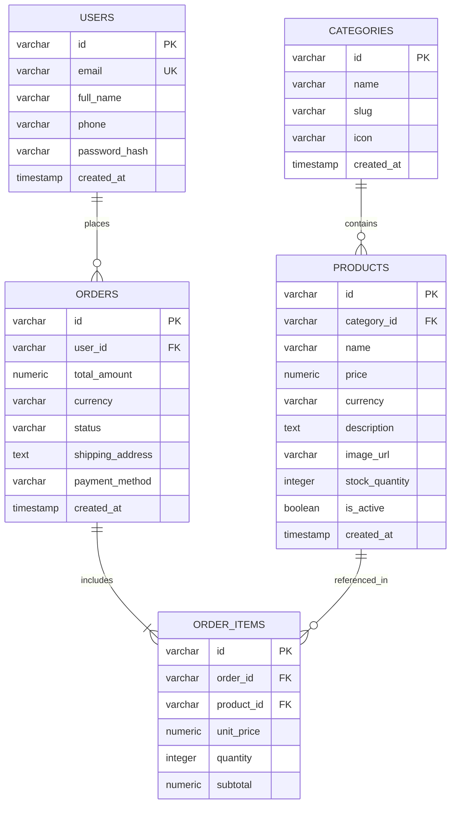

# 🗄️ ANiii STORE — Storage & Relational Schema Reference

**Document Version**: 2.0.0  
**Storage Architecture**: Browser LocalStorage with SafeStorage In-Memory Fallback  
**Status**: Implemented Client Schema & Proposed v2.0 Relational Database  

---

## 1. Architectural Overview & Storage Status

ANiii STORE operates as a client-side web application. All state persistence is managed through the client's browser environment using the HTML5 Web Storage API (`localStorage`), wrapped by our fault-tolerant `SafeStorage` resilience adapter.

> [!IMPORTANT]
> **Active Implementation vs. Future Proposed Design**:
> * **ACTIVE & IMPLEMENTED ON CLIENT (Section 2)**: The browser `localStorage` schema, `CartItem` data contracts, validation rules, JSON serialization, and `SafeStorage` memory fallback.
> * **PROPOSED DESIGN FOR FUTURE BACKEND (Section 3)**: The SQL Relational Schema and Mermaid Entity-Relationship (ER) diagram are **proposed specifications** for a future backend database (v2.0). The current application has **no live database server, SQL tables, or migrations**.

---

## 2. Active Client-Side Storage Schema (`localStorage`)

### 2.1 Storage Key Registry

| Key Name | Storage Type | Serialization Format | Default Value | Description |
| :--- | :--- | :--- | :--- | :--- |
| `cart` | Browser `localStorage` | JSON Array String | `[]` | Persists user cart line-items, quantities, unit prices, and thumbnail references across page navigations, browser restarts, and open tabs. |

---

### 2.2 `CartItem` Data Contract & Constraints

Each entry within the serialized `cart` JSON array conforms to the following schema:

| Property | Type | Required | Constraints & Validation Rules | Failure Recovery Behavior |
| :--- | :--- | :--- | :--- | :--- |
| `name` | `string` | **Yes** | 1 to 120 characters; non-empty after `trim()`; sanitized against XSS on render. | Rejects with `CartValidationError('Product name...', 'name')` on insert; dropped during storage loading if invalid. |
| `price` | `number` | **Yes** | Finite non-negative number (`>= 0`); rounded to 2 decimal places using epsilon arithmetic. | Rejects with `CartValidationError('Product price...', 'price')`; dropped during storage loading if invalid or negative. |
| `quantity`| `number` | **Yes** | Integer between `1` and `99`; auto-capped at `99` on overflow; auto-removed if `<= 0`. | Rejects with `CartValidationError('Quantity...', 'quantity')` if `< 1` on insert; clamped at 99. |
| `image` | `string` | **Yes** | URL string sanitized against `javascript:`, `vbscript:`, and `data:text/html` pseudoprotocols. | Defaults automatically to theme inline SVG data URI (`CONFIG.DEFAULT_FALLBACK_IMAGE`). |

---

### 2.3 Concrete Serialized Example

```json
[
  {
    "name": "Zoro Statue",
    "price": 499.00,
    "quantity": 2,
    "image": "https://encrypted-tbn0.gstatic.com/images?q=tbn:ANd9GcR4ZV1xapPFKFIffE3lv1wTXDAtrjGImBnmDQ&s"
  },
  {
    "name": "Luffy Keychain",
    "price": 49.00,
    "quantity": 1,
    "image": "https://singhchand.com/cdn/shop/files/keyring7_8dd1b79d-6af5-435e-951b-fdbcf4139e75_1800x1800.jpg"
  },
  {
    "name": "One piece Headphone",
    "price": 4999.00,
    "quantity": 1,
    "image": "https://i.etsystatic.com/49920243/r/il/0c462d/6359496771/il_fullxfull.6359496771_egkj.jpg"
  }
]
```

---

### 2.4 Data Lifecycle & Storage Fault-Tolerance Policy

#### 1. Initialization Lifecycle (`_loadFromStorage`)
* Invoked automatically during `new CartService()` instantiation on page load.
* Reads raw string from storage adapter (`storage.getItem(CONFIG.STORAGE_KEY)`).
* If raw data is empty or missing, returns an empty array `[]`.
* **Corrupted JSON Recovery**: If `JSON.parse()` throws a `SyntaxError` (e.g. truncated file or manual user edits in devtools), the exception is caught, a console warning is logged, and the cart cleanly resets to `[]` without throwing an unhandled exception.
* **Non-Array Data Recovery**: If the parsed JSON is an object, number, or string instead of an array, CartService resets to `[]`.
* **Granular Item Cleansing**: Each array element is passed through `_validateItem()`. If one record is corrupted (e.g. missing title or negative price), that single corrupted record is discarded while preserving all valid neighboring items.

#### 2. Persistence Write Lifecycle (`_saveToStorage`)
* Automatically triggered after every successful state mutation:
  * `addItem()`
  * `updateQuantity()`
  * `removeItem()`
  * `clear()`
* Serializes items via `JSON.stringify()` and writes to `SafeStorage.setItem()`.

#### 3. Cross-Tab Storage Synchronization (`setupStorageSync`)
* Registers a window `'storage'` event listener.
* Whenever another browser tab updates the `'cart'` storage key, `cartService.syncFromStorage()` re-reads the storage payload and dispatches notifications to all subscribers, immediately refreshing the cart badge and open drawer in real time.

#### 4. Hardware Quota & Privacy Restrictions (`SafeStorage`)
* **Safari Private Browsing**: Older and strict Safari privacy modes throw a `SecurityError` when accessing `window.localStorage`. `SafeStorage` tests storage access upon initialization; if blocked, it switches seamlessly to an in-memory `Map`.
* **Quota Exceeded (`QuotaExceededError`)**: If browser disk space is full or domain quota is exceeded during `setItem()`, `SafeStorage` catches the exception, switches `isMemoryMode = true`, and stores the data in memory. The user interface remains fully interactive.
* **Write/Delete Failures**: If backend `removeItem` or `clear` throws an error, `SafeStorage` transitions to memory fallback mode and purges its internal `Map`.

---

## 3. Proposed Relational Database Schema (v2.0 Proposal)

> [!NOTE]
> **PROPOSED DESIGN FOR FUTURE BACKEND DEVELOPMENT**  
> The schema below is a planned relational model for a future cloud backend service (PostgreSQL or MySQL). It is **not currently implemented** as an active database in the ANiii STORE repository.

### 3.1 Entity Relationship (ER) Diagram



---

### 3.2 Planned SQL DDL Specification (PostgreSQL / MySQL Compatible)

```sql
-- 1. Product Categories Table
CREATE TABLE categories (
    id VARCHAR(50) PRIMARY KEY,
    name VARCHAR(100) NOT NULL UNIQUE,
    slug VARCHAR(100) NOT NULL UNIQUE,
    icon VARCHAR(10) DEFAULT '📦',
    created_at TIMESTAMP WITH TIME ZONE DEFAULT CURRENT_TIMESTAMP
);

-- 2. Merchandise Products Table
CREATE TABLE products (
    id VARCHAR(50) PRIMARY KEY,
    category_id VARCHAR(50) NOT NULL REFERENCES categories(id) ON DELETE RESTRICT,
    name VARCHAR(120) NOT NULL,
    price NUMERIC(10, 2) NOT NULL CHECK (price >= 0),
    currency VARCHAR(3) DEFAULT 'INR',
    description TEXT,
    image_url VARCHAR(500) NOT NULL,
    stock_quantity INTEGER NOT NULL DEFAULT 0 CHECK (stock_quantity >= 0),
    is_active BOOLEAN DEFAULT TRUE,
    created_at TIMESTAMP WITH TIME ZONE DEFAULT CURRENT_TIMESTAMP
);

CREATE INDEX idx_products_category ON products(category_id);
CREATE INDEX idx_products_active ON products(is_active);

-- 3. Users / Collectors Table
CREATE TABLE users (
    id VARCHAR(50) PRIMARY KEY,
    email VARCHAR(255) NOT NULL UNIQUE,
    full_name VARCHAR(120) NOT NULL,
    phone VARCHAR(20),
    password_hash VARCHAR(255),
    created_at TIMESTAMP WITH TIME ZONE DEFAULT CURRENT_TIMESTAMP
);

-- 4. Customer Orders Table
CREATE TABLE orders (
    id VARCHAR(50) PRIMARY KEY,
    user_id VARCHAR(50) REFERENCES users(id) ON DELETE SET NULL,
    total_amount NUMERIC(10, 2) NOT NULL CHECK (total_amount >= 0),
    currency VARCHAR(3) DEFAULT 'INR',
    status VARCHAR(30) NOT NULL DEFAULT 'pending',
    shipping_address TEXT NOT NULL,
    payment_method VARCHAR(50) NOT NULL,
    created_at TIMESTAMP WITH TIME ZONE DEFAULT CURRENT_TIMESTAMP
);

CREATE INDEX idx_orders_user ON orders(user_id);
CREATE INDEX idx_orders_status ON orders(status);

-- 5. Order Items Table
CREATE TABLE order_items (
    id VARCHAR(50) PRIMARY KEY,
    order_id VARCHAR(50) NOT NULL REFERENCES orders(id) ON DELETE CASCADE,
    product_id VARCHAR(50) NOT NULL REFERENCES products(id) ON DELETE RESTRICT,
    unit_price NUMERIC(10, 2) NOT NULL CHECK (unit_price >= 0),
    quantity INTEGER NOT NULL CHECK (quantity > 0 AND quantity <= 99),
    subtotal NUMERIC(10, 2) NOT NULL CHECK (subtotal >= 0)
);

CREATE INDEX idx_order_items_order ON order_items(order_id);
CREATE INDEX idx_order_items_product ON order_items(product_id);
```
