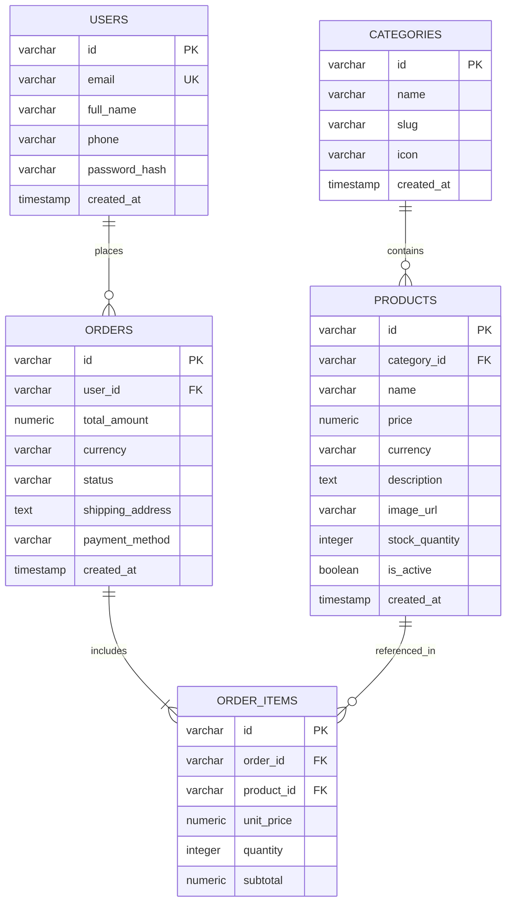

# 🗄️ ANiii STORE - Storage & Database Schema Documentation

## 1. Active Client-Side Storage Architecture

**ANiii STORE** currently operates as a client-side web application. Primary state persistence is managed through the browser's `localStorage` API, wrapped by our custom, fault-tolerant `SafeStorage` adapter.

> [!NOTE]
> The application does not currently require a dedicated database server. The client storage specification below details the active data models stored on the user's device. A proposed relational database schema for future backend migration (v2.0) is detailed in Section 3.

---

## 2. Client-Side Schema (`localStorage`)

### 2.1 Storage Keys Overview

| Key Name | Type | Serialization | Default | Purpose |
| :--- | :--- | :--- | :--- | :--- |
| `cart` | `Array<CartItem>` | JSON String | `[]` | Persists user cart contents, quantities, and item snapshots across page navigations and browser sessions. |
| `cart_version` | `String` | Raw String | `"1.1"` | Schema version identifier used for forward-compatible migrations. |

---

### 2.2 `CartItem` Data Structure

Each entry within the `cart` array represents an anime merchandise item added to the user's shopping basket:

| Field | Type | Required | Constraints & Validation | Description |
| :--- | :--- | :--- | :--- | :--- |
| `name` | `string` | **Yes** | 1 to 120 characters, non-empty after `trim()`, sanitized against XSS. | Unique display name of the anime product. |
| `price` | `number` | **Yes** | Non-negative finite number (`>= 0`), rounded to 2 decimal places using epsilon math. | Unit price in Indian Rupees (INR). |
| `quantity` | `number` | **Yes** | Integer between `1` (min) and `99` (max). Auto-removed if `<= 0`. | Quantity of this product ordered. |
| `image` | `string` | **Yes** | Valid absolute URL or base64 SVG data URI. Defaults to fallback placeholder. | Product thumbnail URL rendered in the cart drawer. |

---

### 2.3 Example Fictional Record

```json
[
  {
    "name": "Zoro Statue",
    "price": 499.00,
    "quantity": 2,
    "image": "https://encrypted-tbn0.gstatic.com/images?q=tbn:ANd9GcR4ZV1xapPFKFIffE3lv1wTXDAtrjGImBnmDQ&s"
  },
  {
    "name": "Luffy Keychain",
    "price": 49.00,
    "quantity": 1,
    "image": "https://singhchand.com/cdn/shop/files/keyring7_8dd1b79d-6af5-435e-951b-fdbcf4139e75_1800x1800.jpg"
  },
  {
    "name": "One piece Headphone",
    "price": 4999.00,
    "quantity": 1,
    "image": "https://i.etsystatic.com/49920243/r/il/0c462d/6359496771/il_fullxfull.6359496771_egkj.jpg"
  }
]
```

---

### 2.4 Storage Lifecycle & Fault-Tolerance Policy

1. **Read Lifecycle (`_loadFromStorage`)**:
   - Executes upon page load (`DOMContentLoaded`).
   - Safely parses JSON inside a `try/catch` boundary.
   - If JSON is malformed or corrupted, automatically catches the `SyntaxError`, logs a warning, resets the key, and returns an empty cart `[]`.
   - Validates every item schema; individual invalid items are discarded without corrupting valid items.
2. **Write Lifecycle (`_saveToStorage`)**:
   - Triggers on `addItem`, `updateQuantity`, `removeItem`, and `clear`.
   - Serializes state with `JSON.stringify()`.
3. **Storage Quota & Private Browsing Resilience (`SafeStorage`)**:
   - If browser storage is disabled (e.g., Safari private browsing, restrictive iframe permissions) or throws `QuotaExceededError`, `SafeStorage` switches to an in-memory `Map` fallback.
   - The user interface continues operating smoothly without throwing fatal unhandled exceptions.

---

## 3. Future Relational Database Schema (v2.0 Proposal)

For future transition to a multi-tenant cloud backend (PostgreSQL / MySQL), the following relational schema is designed with full normalization, foreign key constraints, and performance indexes.

### 3.1 Entity Relationship Diagram



---

### 3.2 SQL DDL Migration (PostgreSQL / MySQL Compatible)

```sql
-- 1. Categories Table
CREATE TABLE categories (
    id VARCHAR(50) PRIMARY KEY,
    name VARCHAR(100) NOT NULL UNIQUE,
    slug VARCHAR(100) NOT NULL UNIQUE,
    icon VARCHAR(10) DEFAULT '📦',
    created_at TIMESTAMP WITH TIME ZONE DEFAULT CURRENT_TIMESTAMP
);

-- 2. Products Table
CREATE TABLE products (
    id VARCHAR(50) PRIMARY KEY,
    category_id VARCHAR(50) NOT NULL REFERENCES categories(id) ON DELETE RESTRICT,
    name VARCHAR(120) NOT NULL,
    price NUMERIC(10, 2) NOT NULL CHECK (price >= 0),
    currency VARCHAR(3) DEFAULT 'INR',
    description TEXT,
    image_url VARCHAR(500) NOT NULL,
    stock_quantity INTEGER NOT NULL DEFAULT 0 CHECK (stock_quantity >= 0),
    is_active BOOLEAN DEFAULT TRUE,
    created_at TIMESTAMP WITH TIME ZONE DEFAULT CURRENT_TIMESTAMP
);

CREATE INDEX idx_products_category ON products(category_id);
CREATE INDEX idx_products_active ON products(is_active);

-- 3. Users Table (Collectors)
CREATE TABLE users (
    id VARCHAR(50) PRIMARY KEY,
    email VARCHAR(255) NOT NULL UNIQUE,
    full_name VARCHAR(120) NOT NULL,
    phone VARCHAR(20),
    password_hash VARCHAR(255),
    created_at TIMESTAMP WITH TIME ZONE DEFAULT CURRENT_TIMESTAMP
);

-- 4. Orders Table
CREATE TABLE orders (
    id VARCHAR(50) PRIMARY KEY,
    user_id VARCHAR(50) REFERENCES users(id) ON DELETE SET NULL,
    total_amount NUMERIC(10, 2) NOT NULL CHECK (total_amount >= 0),
    currency VARCHAR(3) DEFAULT 'INR',
    status VARCHAR(30) NOT NULL DEFAULT 'pending',
    shipping_address TEXT NOT NULL,
    payment_method VARCHAR(50) NOT NULL,
    created_at TIMESTAMP WITH TIME ZONE DEFAULT CURRENT_TIMESTAMP
);

CREATE INDEX idx_orders_user ON orders(user_id);
CREATE INDEX idx_orders_status ON orders(status);

-- 5. Order Items Table
CREATE TABLE order_items (
    id VARCHAR(50) PRIMARY KEY,
    order_id VARCHAR(50) NOT NULL REFERENCES orders(id) ON DELETE CASCADE,
    product_id VARCHAR(50) NOT NULL REFERENCES products(id) ON DELETE RESTRICT,
    unit_price NUMERIC(10, 2) NOT NULL,
    quantity INTEGER NOT NULL CHECK (quantity > 0 AND quantity <= 99),
    subtotal NUMERIC(10, 2) NOT NULL
);

CREATE INDEX idx_order_items_order ON order_items(order_id);
```
